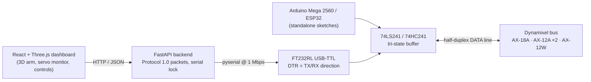

# 4-DOF Robotic Arm — DIY Dynamixel Control Stack

**Open-source hardware, firmware and a full-stack web dashboard to drive Dynamixel AX-series servos over a half-duplex TTL bus — built from scratch, without official Dynamixel controllers.**

Built as a teaching platform for real-time control: understand the actuator bus at the packet level, then drive the arm from a browser.


<!-- Demo GIF / video goes here: docs/media/demo.gif -->

---

## Why this project

Most Dynamixel setups hide the bus behind an official controller board. This project does the opposite: it builds the half-duplex interface with discrete logic (74-series tri-state buffers), speaks Protocol 1.0 byte by byte, and only then layers an API and a 3D dashboard on top. The goal is a platform where students can see — and change — every layer between a click in the browser and a servo moving.

## Architecture



| Layer | What it does | Where |
|---|---|---|
| **Hardware** | Half-duplex TTL interface built from tri-state buffers; three variants (Arduino Mega, FT232RL, ESP32) | [`half_duplex_circuits/`](half_duplex_circuits), [`datasheets/`](datasheets) |
| **Firmware** | Arduino/ESP32 sketches: bus scan, absolute positioning in joint mode, per-servo position seeking | [`basic_br_control/arduino_sketches/`](basic_br_control/arduino_sketches) |
| **Host scripts** | Python over FT232RL with DTR-switched direction: ping, read registers, absolute rotation | [`basic_br_control/python_scripts/ft232rl/`](basic_br_control/python_scripts/ft232rl) |
| **API** | FastAPI service that builds and checksums Protocol 1.0 packets, with a lock so concurrent requests never collide on the bus | [`ui_ux_webapp/back_end/app.py`](ui_ux_webapp/back_end/app.py) |
| **Dashboard** | React + React Three Fiber: live 3D arm, per-servo telemetry, control panel, emergency stop, command history | [`ui_ux_webapp/front_end/`](ui_ux_webapp/front_end) |

## Hardware

**Servos:** AX-18A, AX-12A (×2), AX-12W — Dynamixel Protocol 1.0 at 1 Mbps.

**Bus interface variants**

| # | Host | Buffer | Notes |
|---|---|---|---|
| 1 | Arduino Mega 2560 (Serial1) | 74LS241 | Direction pin drives the buffer enables |
| 2 | Mac/PC via FT232RL USB-TTL | 74LS241 / 74HC241 | **DTR line** selects TX/RX; servos on external 12 V / 3 A |
| 3 | ESP32 DevKit V1 | TXS0108E level shifter + 74LS241 | 3.3 V logic; path toward wireless control |

Tested buffer alternatives: HD74LS241P, SN74HC125N, SN74HC126N — or a 74LS244 plus an inverter (74LS04 / 74HC04).

<p align="center">
  
  
</p>

The FT232RL guide ([`basic_br_control/python_scripts/ft232rl/readme.md`](basic_br_control/python_scripts/ft232rl/readme.md), in Spanish) covers wiring, the DTR truth table, TX→RX timing and packet formats (PING, READ, WRITE, SYNC WRITE).

## API

| Method | Endpoint | Purpose |
|---|---|---|
| `GET` | `/api/status` | Service health, serial port and baud rate |
| `POST` | `/api/move` | Move one servo to an absolute angle (0–300°) |
| `POST` | `/api/stop` | Disable torque on all servos (broadcast) |
| `POST` | `/api/resume` | Re-enable torque on all servos |
| `POST` | `/api/reset` | Return the arm to its home pose |
| `POST` | `/api/torque` | Toggle torque per servo |
| `GET` | `/api/inspect/{id}` | Position, speed, load, voltage and temperature of one servo |
| `GET` | `/api/inspect?ids=1,2,3,4` | Same telemetry for several servos (polled by the dashboard) |

## Quick start

**1. Backend (FastAPI)**

```bash
cd ui_ux_webapp/back_end
python -m venv .venv && source .venv/bin/activate
pip install -r requirements.txt
export DXL_PORT=/dev/tty.usbserial-XXXX   # your FT232RL port
export DXL_BAUD=1000000
uvicorn app:app --reload --port 8000
```

**2. Dashboard (React + Vite)**

```bash
cd ui_ux_webapp/front_end
npm install
echo "VITE_API_URL=http://localhost:8000" > .env.local
npm run dev
```

**3. Firmware (optional, standalone)** — open a sketch from `basic_br_control/arduino_sketches/` in the Arduino IDE. The Dynamixel libraries used are vendored in `libraries/` (zipped copies in `backups/`).

## Results

- Reliable half-duplex communication at **1 Mbps** with no official controller.
- **≤ 2° repeatability** measured on the bench.
- Clean, safe start-up (no torque jerks) and live telemetry for every joint.
- One stack from packet bytes to a 3D web UI: C++ · Python · FastAPI · React · Three.js.

## Roadmap

- [ ] SYNC WRITE in the API for smooth multi-joint motion
- [ ] WebSocket / SSE stream to replace polling
- [ ] Ziegler–Nichols auto-tuning and live data logging (PID, bang-bang, cascade comparisons)
- [ ] ROS 2 integration for kinematics and computer vision ([`roboctrl_ws`](https://github.com/LordSnakeZ/roboctrl_ws))
- [ ] Demo video and photos of the assembled arm

## Repository layout

```
basic_br_control/       Arduino/ESP32 sketches, vendored libraries, FT232RL Python scripts
half_duplex_circuits/   Interface schematics (Robotis reference + simplified build)
datasheets/             Servos, microcontrollers, buffers and inverters
ui_ux_webapp/           FastAPI backend + React/Three.js dashboard
backups/                Zipped copies of the Arduino libraries
```

## Author

**Santiago S. Sánchez** — Mechatronics Engineer (UNAM) · AI Engineer
[LinkedIn](https://www.linkedin.com/in/san-sanchez/) · [GitHub](https://github.com/LordSnakeZ)

Released under the [MIT License](LICENSE).
